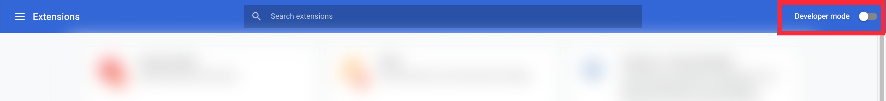
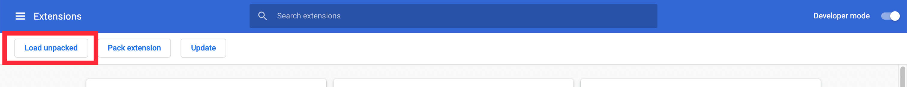

# Development

## Prerequisites

| Tool       | Version                                                                                        |
| ---------- | ---------------------------------------------------------------------------------------------- |
| Node.js    | 24.22.1 (see `.nvmrc`; Volta pins it too)                                                      |
| Yarn       | 4.7.0 (Volta pins it too; CI runs `corepack enable`)                                           |
| npm access | Member of `@avalabs` on npmjs.com, with 2FA enabled. The project uses private `@avalabs` SDKs. |

Volta is optional. Any tool that reads `.nvmrc`, such as `nvm`, works.

## Environment files

| File              | Used by                                                                               |
| ----------------- | ------------------------------------------------------------------------------------- |
| `.env.example`    | Template. Copy it to `.env.dev` for local development.                                |
| `.env.dev`        | `yarn dev` and `yarn start`.                                                          |
| `.env.production` | Local production builds only. CI writes it from the `production` environment secrets. |
| `e2e/.env`        | End-to-end tests. Copy it from `e2e/.env.example`.                                    |

## Setup and run

1. Install dependencies and allow the build scripts:

   ```bash
   yarn setup
   ```

2. Copy `.env.example` to `.env.dev` and fill in the values. See [required variables](#required-variables).
3. Build the extension into `dist/`:

   ```bash
   yarn dev
   ```

4. Load it in Chrome:

   1. Open `chrome://extensions/`.
   2. Turn on **Developer mode** at the top right.

      

   3. Click **Load unpacked** at the top left.

      

   4. Select the `dist` folder.

## Commands

| Command                                        | What it does                                                                                                                |
| ---------------------------------------------- | --------------------------------------------------------------------------------------------------------------------------- |
| `yarn setup`                                   | `yarn install` and `yarn allow-scripts`.                                                                                    |
| `yarn dev` (or `yarn start`)                   | Development build into `dist/`, using `.env.dev`.                                                                           |
| `yarn build`                                   | Production build into `dist/`.                                                                                              |
| `yarn build:alpha`                             | Alpha build.                                                                                                                |
| `yarn build:dev`                               | Development build. `:no-source-maps` variants are available.                                                                |
| `yarn test`                                    | Unit tests. Also `test:watch`, `test:path <pattern>` and `test:coverage`.                                                   |
| `yarn coverage:check` / `yarn coverage:update` | Check or update the coverage ratchet in `coverage-baseline.json`.                                                           |
| `yarn lint`                                    | Lint.                                                                                                                       |
| `yarn prettify`                                | Format.                                                                                                                     |
| `yarn typecheck`                               | Type check.                                                                                                                 |
| `yarn scanner`                                 | Run the i18next scanner. CI fails if its output changes. See [Localization](07-Localization.md).                            |
| `yarn generate-clients`                        | Regenerate the API clients. Needs network access to the spec URLs. See `packages/service-worker/src/api-clients/README.md`. |
| `yarn zip`                                     | Package `dist/` into a zip in `builds/`. See [Release](release.md).                                                         |

End-to-end tests need a built `dist/`:

```bash
cd e2e
yarn install
npx playwright install chromium
cp .env.example .env
yarn test
```

## Required variables

The service worker reads these at runtime. `FIREBASE_CONFIG` and `GASLESS_SERVICE_URL` are required: the service worker throws at startup without them.

| Variable                          | Purpose                                            |
| --------------------------------- | -------------------------------------------------- |
| `PROXY_URL`                       | `proxy-api-worker` base URL                        |
| `CORE_WEB_BASE_URL`               | Core web app, for links and deep links             |
| `GLACIER_URL`                     | Recognises Glacier RPC URLs (not called directly)  |
| `CORE_PROXY_GLACIER_BASE_URL`     | `core-proxy-api` Glacier base URL                  |
| `FIREBASE_CONFIG`                 | Base64 Firebase config (App Check, FCM, Vertex AI) |
| `ID_SERVICE_URL`                  | `core-id-api` base URL                             |
| `GASLESS_SERVICE_URL`             | `core-gas-station-api` base URL                    |
| `NOTIFICATION_SENDER_SERVICE_URL` | `core-notification-sender-api` base URL            |
| `BALANCE_SERVICE_URL`             | `core-balance-api` base URL                        |
| `PROFILE_SERVICE_URL`             | `core-profile-api` base URL                        |
| `TOKEN_AGGREGATOR_SERVICE_URL`    | `token-aggregator-api` base URL                    |
| `POSTHOG_KEY`                     | PostHog project key for analytics events           |

The backend URLs and their routes are listed in the [Overview](index.md#backend-dependencies).
