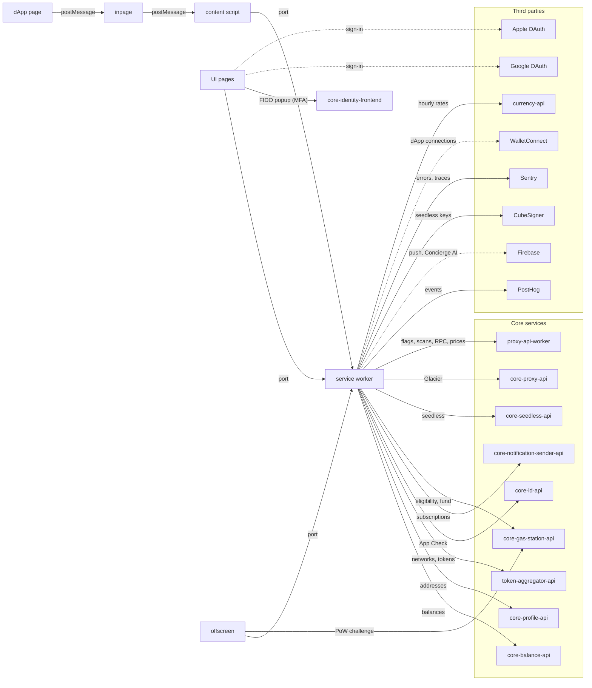

# core-extension

Core Wallet is a non-custodial Chrome browser extension (Manifest V3) for Bitcoin, EVM chains, Avalanche and Solana. It injects an EIP-1193 and EIP-6963 provider into web pages, so dApps can request accounts and signatures. The service worker holds the wallet state and talks to Core's backend services. The extension is published on the [Chrome Web Store](https://chrome.google.com/webstore/detail/core-crypto-nft-wallet-ex/agoakfejjabomempkjlepdflaleeobhb).

The deeper design lives in the numbered pages. Start with [Architecture](01-Architecture.md), then [Service worker](02-Service-worker.md) and [Storage](03-Storage.md). [Frontend](04-Frontend.md) and [Dapp connections](05-Dapp-connections.md) cover the UI and the page-facing provider. The integration pages cover [Ledger](06-Ledger.md), [Localization](07-Localization.md), [Analytics and feature flags](08-Analytics-and-Feature-Flags.md) and [Seedless](10-Seedless.md).

## Pieces

| Workspace                                                                    | Role                                                                                                                                                                  |
| ---------------------------------------------------------------------------- | --------------------------------------------------------------------------------------------------------------------------------------------------------------------- |
| `apps/next`                                                                  | React 19 UI: popup, home, fullscreen, confirm and side panel pages. The manifest is in `apps/next/manifest`.                                                          |
| `packages/service-worker`                                                    | MV3 background service worker. Single source of truth: encrypted `chrome.storage`, services, VM modules, generated API clients, App Check, notifications and gasless. |
| `packages/content-script`                                                    | Bridges page `postMessage` and the service worker port.                                                                                                               |
| `packages/inpage`                                                            | EIP-1193 and EIP-6963 provider, injected into the page's MAIN world.                                                                                                  |
| `packages/offscreen`                                                         | Offscreen document that solves the gasless proof-of-work challenge with `@avalabs/core-gasless-sdk`.                                                                  |
| `packages/messaging`, `ui`, `common`, `types`, `tsconfig`, `lavamoat-rspack` | Shared libraries and the LavaMoat build plugin.                                                                                                                       |

## Backend dependencies

The extension never names these services in code. Each base URL is an env var set per build from a CI secret. Routes were matched against the backend services' specs.

| Service                        | Env var                           | Used for                                                                                                                                                                                                                   | Called from                                                                                                                                                                                                 |
| ------------------------------ | --------------------------------- | -------------------------------------------------------------------------------------------------------------------------------------------------------------------------------------------------------------------------- | ----------------------------------------------------------------------------------------------------------------------------------------------------------------------------------------------------------- |
| `core-balance-api`             | `BALANCE_SERVICE_URL`             | Token balances (`POST /v1/balance/get-balances`)                                                                                                                                                                           | `BalanceAggregatorService`                                                                                                                                                                                  |
| `core-profile-api`             | `PROFILE_SERVICE_URL`             | Address resolution (`POST /v1/get-addresses`)                                                                                                                                                                              | `services/secrets/AddressResolver.ts`                                                                                                                                                                       |
| `token-aggregator-api`         | `TOKEN_AGGREGATOR_SERVICE_URL`    | Networks with RPC URLs and explorers (`/v2/networks`), token lists (`/v2/tokens`), token lookup (`/v1/token/lookup`)                                                                                                       | `NetworkService`, `TokenManagerService`, transfer tracking                                                                                                                                                  |
| `core-id-api`                  | `ID_SERVICE_URL`                  | App Check challenge: `POST /v2/ext/register` and `/v2/ext/verify`. Release CI also calls `/v2/ext/submit-build`.                                                                                                           | `services/appcheck/AppCheckService.ts`                                                                                                                                                                      |
| `core-notification-sender-api` | `NOTIFICATION_SENDER_SERVICE_URL` | Push registration, balance, news and recurring-swap subscriptions, notification center                                                                                                                                     | `services/notifications`                                                                                                                                                                                    |
| `core-gas-station-api`         | `GASLESS_SERVICE_URL`             | Gasless eligibility and funding (`/v1/evm/eligibility`, `/v1/evm/fund`) and the PoW challenge (`/v1/challenges`)                                                                                                           | `services/gasless/GasStationService.ts`, offscreen                                                                                                                                                          |
| `core-seedless-api`            | `SEEDLESS_URL`                    | Seedless registration, account add and key derivation (`/v1/register`, `/v1/addAccount`, `/v1/deriveMissingKeys`). The Apple sign-in redirect relays through it.                                                           | `SeedlessWallet.ts`, `approveSeedlessRegistration.ts`                                                                                                                                                       |
| `core-proxy-api`               | `CORE_PROXY_GLACIER_BASE_URL`     | Glacier (`evmChains.listAddressChains`) and the VM modules' Glacier traffic. Sends `X-Firebase-AppCheck`, and `X-Core-Api-Key` when `CORE_PROXY_API_KEY` is set. Development builds set it; the production build does not. | `GlacierService`, `vmModules/ModuleManager.ts`                                                                                                                                                              |
| `proxy-api-worker`             | `PROXY_URL`                       | PostHog feature flags (primary source), Blockaid scans, DeBank, NOWNodes Solana and Bitcoin RPC, watchlist prices and trending, Markr (`MARKR_API_URL`). No API key is sent.                                               | `getFeatureFlags.ts`, `BlockaidService`, `DebankService`, `getProviderForNetwork.ts`, `getBtcProvider.ts`, `getSolanaProvider.ts`, `TokenPricesService`, `TrendingTokensService`, Markr service initializer |

Hardcoded production hosts apply to every build:

| Host                                             | Used for                                             |
| ------------------------------------------------ | ---------------------------------------------------- |
| `proxy-api.avax.network/proxy/nownodes/hype/evm` | HyperEVM RPC                                         |
| `cdn.jsdelivr.net`                               | Currency rates (`@fawazahmed0/currency-api`, hourly) |

Seedless MFA with a passkey or security key opens a popup at `SEEDLESS_FIDO_IDENTITY_URL`, with `/register` and `/authenticate` paths (`launchFidoFlow`, called from the UI). The popup is `core-identity-frontend` (identity.core.app, see [its repository](https://github.com/ava-labs/core-identity-frontend)). It returns the credential with `postMessage`, so the extension IDs must stay in its allowed origins.

## Third parties

| Third party             | Used for                                                                                                            | Called from                                         |
| ----------------------- | ------------------------------------------------------------------------------------------------------------------- | --------------------------------------------------- |
| PostHog                 | Analytics events (`POSTHOG_URL`), feature-flag fallback                                                             | service worker                                      |
| Firebase                | App Check (tokens from `core-id-api`), FCM push (behind a feature flag), Vertex AI `gemini-2.5-flash` for Concierge | service worker (`FirebaseService`)                  |
| CubeSigner              | Seedless key operations: sessions, identity, signing, export, MFA, FIDO                                             | service worker (`SeedlessWallet`)                   |
| Google OAuth            | Seedless sign-in via `chrome.identity`                                                                              | UI sign-in button, `packages/common` seedless utils |
| Apple OAuth             | Seedless sign-in, redirect through `core-seedless-api`                                                              | UI sign-in button, `packages/common` seedless utils |
| Sentry                  | Error and trace reporting                                                                                           | service worker, UI                                  |
| WalletConnect           | dApp connections over the WalletConnect relay                                                                       | service worker (`WalletConnectService`)             |
| currency-api (jsDelivr) | Currency rates                                                                                                      | service worker (`CurrencyService`)                  |
