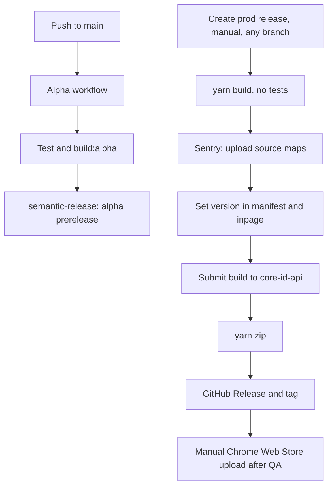

# Release

## Versioning

Versions are set by semantic-release from [Conventional Commits](https://www.conventionalcommits.org/en/v1.0.0/) on the branch being released.

| Commit                                                                                                  | Version bump |
| ------------------------------------------------------------------------------------------------------- | ------------ |
| `feat`                                                                                                  | Minor        |
| `BREAKING CHANGE` or `BREAKING CHANGES` in the message                                                  | Major        |
| Any other type (`fix`, `build`, `chore`, `ci`, `docs`, `style`, `refactor`, `perf`, `test`, or no type) | Patch        |

## Alpha releases

Every push to `main` runs the alpha workflow (`.github/workflows/main_branch.yaml`) in the `alpha` environment:

1. Install dependencies, then `yarn test`.
2. `yarn build:alpha`, then the Sentry setup.
3. semantic-release publishes a GitHub prerelease with the zip attached. Alpha versions always bump the patch number.

## Production releases

Production releases come from the `Create prod release` workflow (`.github/workflows/create_release.yaml`).

- Trigger it manually from **Actions** with **Run workflow**. It runs on any branch, so hotfixes work the same way.
- It runs in the `production` environment with `RELEASE=production`, builds with `yarn build`, and has no test step.
- semantic-release runs against the selected branch. It tags the commit and creates the GitHub Release.
- The Chrome Web Store upload is manual. Upload the build after QA gives the green light.

Before you run it, make sure the branch is clean and ready.

### What semantic-release does, in order

The plugin chain is defined in `.releaserc.js`:

1. **Sentry release:** `yarn sentry core-extension@<version>` injects and uploads the source maps, then deletes the `*.js.map` files from `dist/`.
2. **Replace version:** writes the version into `dist/manifest.json` and into `CORE_EXTENSION_VERSION` in `dist/inpage/js/inpage.js`.
3. **Submit build:** POSTs JSON to `${ID_SERVICE_URL}/v2/ext/submit-build` (headers `X-App-Version` = manifest version, `X-Api-Key` = the CI-only `ID_SERVICE_API_KEY`). The body is `{ manifest, pathChecksumMap }`: `manifest` is the whole `dist/manifest.json`, base64-encoded; `pathChecksumMap` maps each `dist/` `.js` file path (relative to `dist/`, files with `node_modules` in the name skipped) to the SHA-256 hex of the string `<manifest.version>:<base64 of the file's bytes>`, so a plain file hash will not match. The `core-id-api` service stores it for the extension's App Check checks. See [core-id-api](index.md#backend-dependencies).
4. **Zip:** `yarn zip` packages `dist/`.
5. **GitHub Release:** attaches the zip to the release.

## Local production build

Only use this for testing. Store submissions must come from CI.

1. Create `.env.production` from `.env.example`, with production values.
2. Run `yarn`.
3. Run `yarn build`. The build goes into `dist/`.
4. Run `yarn zip`. The zip goes into `builds/`.
